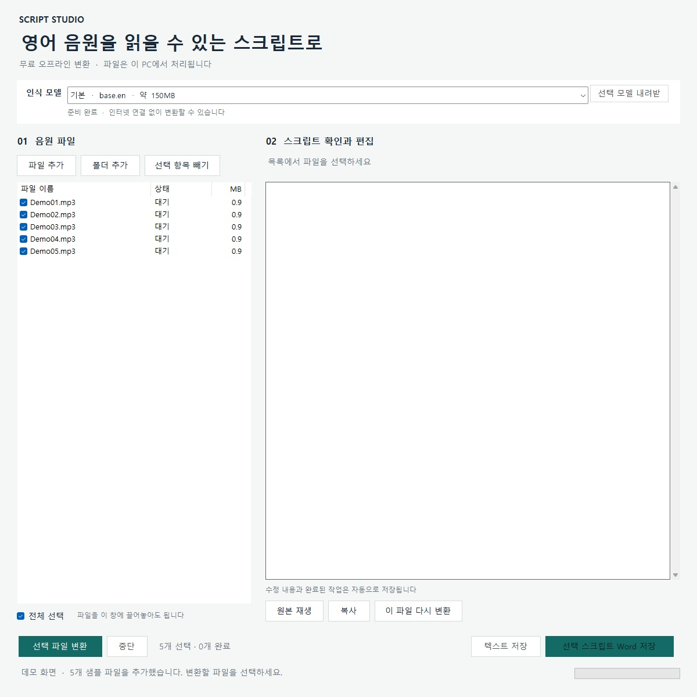
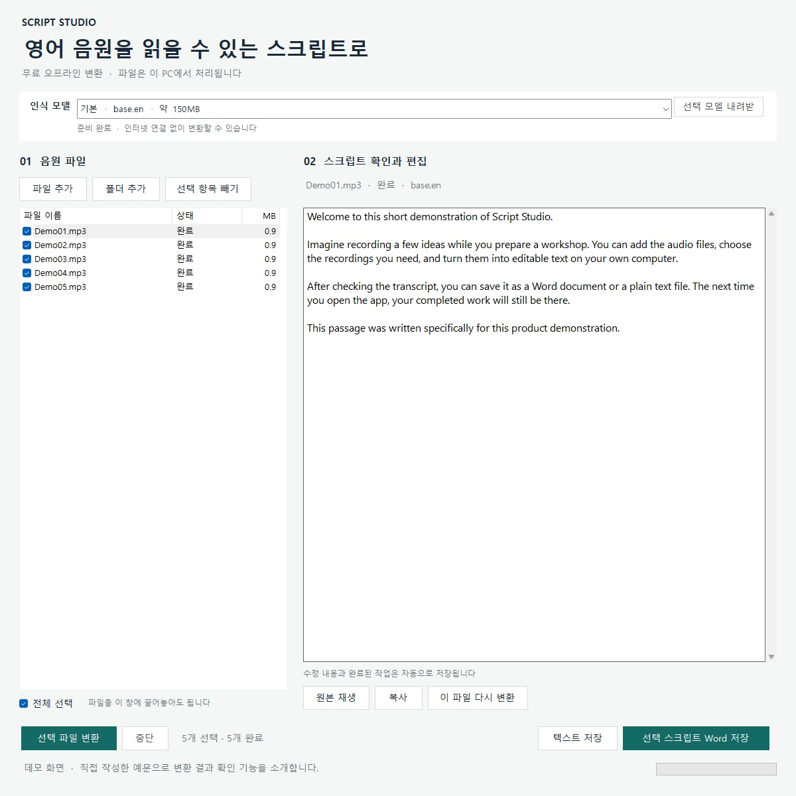
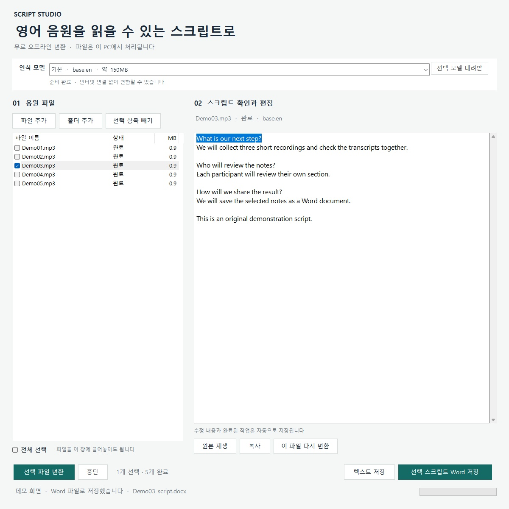

# Script Studio

영어 MP3를 스크립트로 바꾸는 **무료 오프라인 Windows 앱**입니다.
여러 파일을 순서대로 변환하고, 결과를 편집한 뒤 Word 또는 텍스트로 저장합니다.

> **저작권 안내:** 본인이 권리를 보유하거나 전사·공유를 허락받은 자료 등 적법하게 이용할 수 있는 음원을 사용하세요. 음원을 텍스트로 바꾸어도 원본의 저작권이 사라지지 않습니다. 교재·강의 등의 전사본이나 본문이 보이는 캡처를 공개하기 전에는 별도로 이용 권한을 확인해야 합니다. [저작권 및 라이선스 상세 안내](COPYRIGHT.md)

## 화면 미리보기

직접 작성한 예문과 샘플 파일 목록을 사용한 기능 시연 화면입니다. 이미지를 누르면 원본 크기로 볼 수 있습니다.

| 음원 파일 선택 | 변환 결과 확인 | 스크립트 편집과 Word 저장 |
| --- | --- | --- |
| [](docs/screenshots/01_audio_queue.jpg) | [](docs/screenshots/02_transcription_complete.jpg) | [](docs/screenshots/03_edit_and_export.jpg) |

## 다운로드와 실행

1. [최신 릴리스](https://github.com/Kay-lucas/script-studio/releases/latest)에서 `ScriptStudio-Windows.zip`을 받습니다.
2. 압축을 폴더에 모두 풉니다.
3. `ScriptStudio.exe`를 실행합니다.
4. 음원을 추가하고 파일 왼쪽 체크 상자를 선택한 뒤 **선택 파일 변환**을 누릅니다.

기본 영어 모델 `base.en`이 포함되어 있습니다. 압축 파일은 약 138MB, 압축을 푼 앱은 약 160MB입니다.
기본 모델로 변환할 때는 인터넷 연결, 회원 가입, API 키, API 이용 요금이 필요하지 않습니다.

지원 환경은 Windows 10/11 64비트, .NET Framework 4.8입니다.
음성 인식 실행 도구에는 Microsoft Visual C++ x64 실행 구성 요소도 필요합니다.
누락된 PC에서는 앱이 안내하며, [Microsoft 공식 설치 파일](https://aka.ms/vc14/vc_redist.x64.exe)로 준비할 수 있습니다.

## 주요 기능

- MP3, WAV, FLAC, OGG 파일 여러 개 추가 및 끌어놓기
- Day1, Day2, Day10처럼 숫자가 있는 파일 이름을 숫자 순서로 정렬
- 체크한 파일만 변환, 완료된 파일 자동 건너뛰기
- 변환 중단 및 완료된 파일을 유지한 채 이어서 작업
- 스크립트 확인·편집 및 자동 저장
- 원본 음원 재생
- 선택한 스크립트를 하나의 `.docx` 또는 `.txt`로 저장
- 한글 폴더와 파일 이름 지원
- 같은 경로의 파일 중복 추가 방지

Word 문서는 파일별로 새 페이지에서 시작합니다. Word가 설치되어 있지 않아도 문서를 만들 수 있습니다.
변환 속도와 정확도는 PC 성능과 녹음 상태에 따라 달라지므로, 중요한 내용은 원본과 대조하세요.

## 모델 선택

| 모델 | 모델 파일 크기 | 용도 |
| --- | ---: | --- |
| base.en | 약 150MB | 기본 모델, 릴리스에 포함 |
| small.en | 약 490MB | 정확도를 더 중시할 때 선택 |
| tiny.en | 약 80MB | 빠른 초안 |

앱 위쪽 목록에서 모델을 고르고 **선택 모델 내려받기**를 누르면 추가 모델을 받을 수 있습니다.
모델을 준비할 때만 인터넷이 필요하며, 다운로드된 모델은 SHA1 체크섬으로 검증합니다.
모델 출처는 [whisper.cpp 공식 모델 안내](https://github.com/ggml-org/whisper.cpp/blob/master/models/README.md)를 따릅니다.

## 작업 저장과 파일 관리

자동 저장 내용은 실행 파일 옆 `data/` 폴더에 남습니다. 이 폴더에는 원본 음원 경로와 스크립트가 들어 있습니다.
앱을 옮길 때는 폴더 전체를 옮기고, 기존 작업을 보존하려면 `data/`도 함께 백업하세요.
원본 음원 위치가 달라졌다면 목록에서 이전 항목을 빼고 새 위치의 파일을 추가하면 됩니다.

음성 변환은 로컬 CPU에서 실행합니다. 음원과 스크립트를 외부 서버로 보내지 않습니다.
이 저장소와 릴리스에는 사용자의 음원, 자동 저장 데이터, 변환된 스크립트를 포함하지 않습니다.

자세한 사용법은 [사용안내](docs/사용안내.txt)를 참고하세요.

## 소스에서 빌드

Windows 64비트에서 PowerShell을 열고 실행합니다. Python, Node.js, 유료 API는 필요하지 않습니다.

```powershell
powershell -ExecutionPolicy Bypass -File .\scripts\build.ps1
powershell -ExecutionPolicy Bypass -File .\scripts\prepare-runtime.ps1
.\build\ScriptStudio-Windows\ScriptStudio.exe
```

첫 번째 명령은 Windows의 .NET Framework C# 컴파일러로 앱을 빌드합니다.
두 번째 명령은 공식 Windows CPU 실행 도구와 기본 모델을 내려받고 체크섬을 검증합니다.
이미 같은 파일이 있다면 검증 후 재사용합니다. 다운로드에는 인터넷 연결이 필요합니다.

배포용 압축 파일을 만들려면 다음을 실행합니다.

```powershell
powershell -ExecutionPolicy Bypass -File .\scripts\package.ps1
```

출력은 `dist/ScriptStudio-Windows.zip`입니다. 패키징할 때 개인 작업 데이터는 제외합니다.

## 검증

로컬 기본 검증은 다음 명령으로 실행할 수 있습니다.

```powershell
$test = Start-Process .\build\ScriptStudio-Windows\ScriptStudio.exe -ArgumentList '--self-test' -Wait -PassThru
$test.ExitCode
```

성공하면 종료 코드는 `0`입니다. Word 문서 구조, 한글·특수문자, 텍스트 저장, 숫자 정렬,
지원 파일 검사, 경로 인수 처리, 파일 교체 저장을 확인합니다. 테스트 결과는 앱의 `data/self-test/`에 생성됩니다.

실제 음원 폴더에 `Day01.mp3`부터 `Day05.mp3`까지 있다면 추가 통합 시험도 가능합니다.
시험은 해당 음원을 외부로 보내지 않으며 `data/` 안에 시험 목록과 결과를 만듭니다.
개인 작업이 들어 있는 앱 폴더 대신 시험용 빌드 폴더에서 실행하세요.

```powershell
$test = Start-Process .\build\ScriptStudio-Windows\ScriptStudio.exe -ArgumentList @('--ui-test', '"C:\path\to\audio"') -Wait -PassThru
$test.ExitCode
```

초기 버전은 실제 MP3 5개 변환, 체크한 파일 처리, 중복 추가 방지, 편집 내용 복원,
완료 파일 건너뛰기, Word·텍스트 저장, 한글 파일 이름, 실행 중 중단과 임시 파일 정리를 검증했습니다.

## 구성과 타사 라이선스

- `src/ScriptStudio.cs`: Windows Forms UI, 작업 목록, 음성 인식 연동, Word 내보내기
- `scripts/`: 빌드, 실행 도구 준비, 패키징
- `docs/`: 사용 안내
- `licenses/` 및 `THIRD_PARTY.txt`: 타사 라이선스와 출처

음성 인식 도구는 [whisper.cpp](https://github.com/ggml-org/whisper.cpp), 모델은
[OpenAI Whisper](https://github.com/openai/whisper)의 영어 모델을 사용합니다.
해당 구성 요소의 MIT 라이선스 원문을 함께 제공합니다.
재배포 시 해당 저작권·허가 고지를 유지해야 합니다. 타사 구성 요소의 MIT 라이선스는
사용자가 입력한 음원이나 전사본의 공개·배포를 허락하는 라이선스가 아닙니다.

자체 코드의 라이선스 상태, 데모 이미지의 출처, 콘텐츠 이용 시 확인할 사항은
[저작권 및 라이선스 안내](COPYRIGHT.md)에 정리했습니다.
